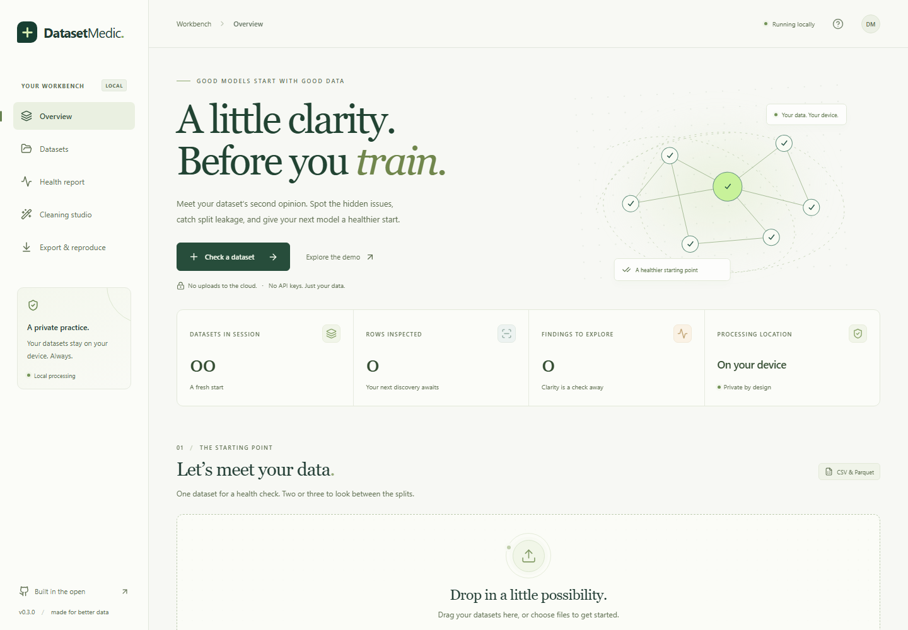
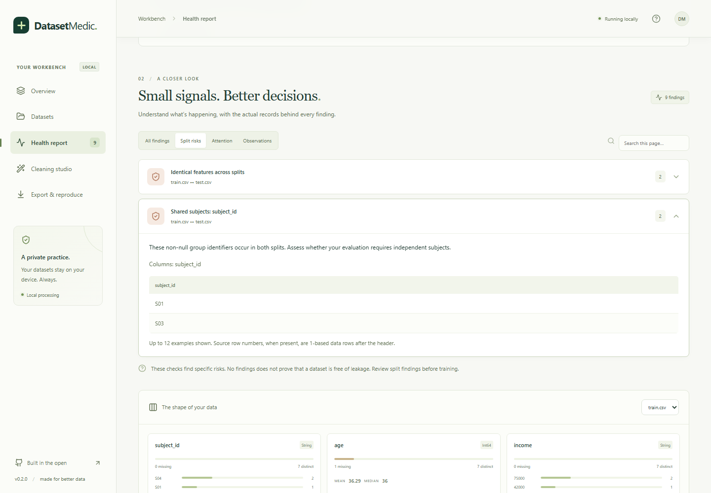
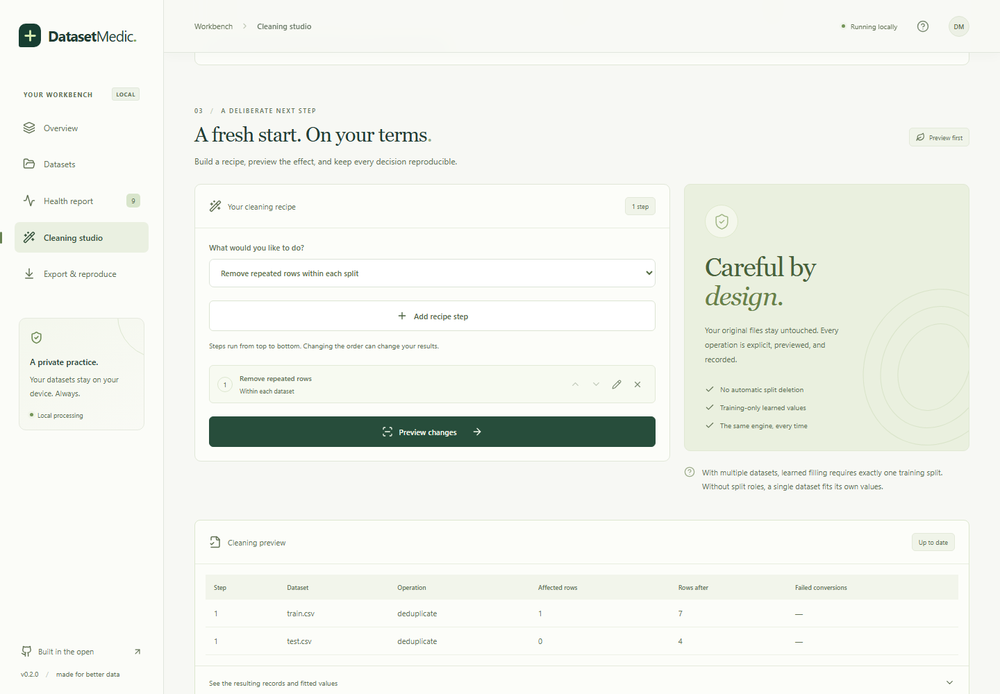
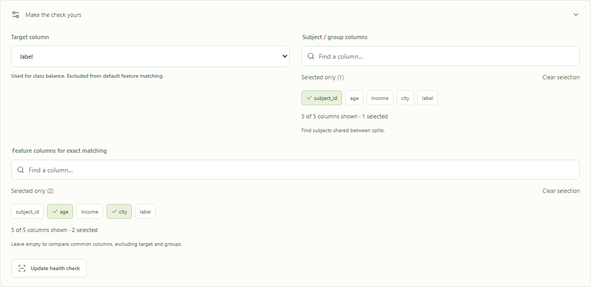
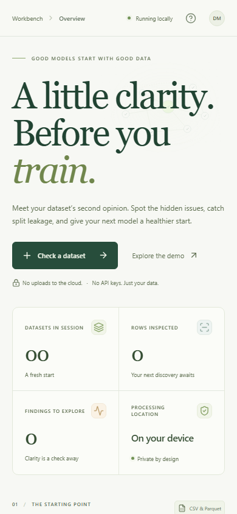

<div align="center">

# DatasetMedic 🌱

### A little clarity. Before you train.

**A local workbench for healthier datasets — and more trustworthy ML experiments.**

[](https://github.com/Aadithya-Ram/DatasetMedic/actions/workflows/ci.yml)
[](https://www.python.org/downloads/)
[](web/src/App.tsx)
[](LICENSE)

[Download](https://github.com/Aadithya-Ram/DatasetMedic/releases/latest) · [How it works](#one-workbench-four-thoughtful-steps) · [Develop](DEVELOPMENT.md) · [Report a bug](https://github.com/Aadithya-Ram/DatasetMedic/issues)



</div>

Your model’s evaluation is only as useful as the data behind it. DatasetMedic helps you find the records worth investigating: missing values, mixed types, repeated rows, and subjects or feature records shared across supposedly separate splits.

Open CSV or Parquet files, inspect the evidence, preview deliberate cleaning, and take away a reproducible bundle. **Your files stay on your computer. No cloud account. No API key. No subscription.**

## Get started

Requires **Python 3.11 or newer**. The downloadable wheel includes the built interface; Node is only needed for development.

```shell
python -m pip install https://github.com/Aadithya-Ram/DatasetMedic/releases/download/v0.2.0/datasetmedic-0.2.0-py3-none-any.whl
datasetmedic
```

A browser opens to the local app. Click **Explore the demo** for two small synthetic datasets with known problems. Or import your own files and run a health check.

```shell
# Pick a specific local port; useful on a research workstation.
datasetmedic --port 8765 --no-browser
```

The server listens on `127.0.0.1`. Press **Ctrl+C** in the terminal when finished to stop it and remove session data.

## One workbench. Four thoughtful steps.

| Step | What you can do |
| --- | --- |
| **1 · Import** | Open up to three CSV/Parquet files. Assign training, validation or test roles. Choose a target, subject/group columns, and feature columns. |
| **2 · Inspect** | Review missing values, constants, mixed numeric/text columns, duplicates, class counts, schema differences, and split summaries. Expand findings to see actual examples. |
| **3 · Preview** | Build an ordered recipe: remove within-split duplicates, trim whitespace, drop columns, convert types, and fill missing values. Inspect affected rows and failed conversions before exporting. |
| **4 · Reproduce** | Download cleaned data, a standalone HTML report, a Python script, the recipe, source fingerprints, fitted values, and dependency versions in one ZIP. |

### Look between the splits

Exact feature matching catches records shared across different split roles. User-selected group columns reveal shared subjects. Hashing narrows candidates; equality over the selected feature values verifies matches, so hash collisions cannot create false overlap findings.



Select meaningful features: an ID included in record matching can hide otherwise identical examples. Group overlap may be appropriate for some tasks; DatasetMedic shows evidence so you can make that decision.

### Clean with a paper trail

Preview and export use the same transformation engine. Learned fills use **only the assigned training dataset**, then reuse those values in validation/test data. A single unassigned dataset fits its own values; multiple datasets require one training assignment for learned fills. The app never automatically deletes overlapping records across splits.



Failed type conversions create null values and are counted in the preview. Export requires acknowledging those failures. Numeric median filling preserves fractional values, and tied modes use deterministic ordering.

**New in v0.2.0:** edit saved recipe steps or move them earlier/later without rebuilding the recipe. A changed recipe needs a fresh preview before export. Boolean constant fills accept `true`, `false`, `1` and `0`. Large integer IDs are displayed as exact text rather than rounded browser numbers. See the [changelog](CHANGELOG.md).

**On `main` (next release):** searchable column pickers for subject groups, feature matching and cleaning. Filter names, review selected columns and keep selections across searches, even with 500 columns. The v0.2.0 download above is preserved; these additions currently require the source installation.



### What’s in an export?

```text
datasetmedic-export.zip
├── dataset-1.parquet       # or CSV; one file per imported dataset
├── dataset-2.parquet
├── report.html             # findings for the cleaned data
├── summary.json            # changes, failures, fitted values, profiles
├── recipe.json             # ordered operations and source fingerprints
├── reproduce.py            # uses the same DatasetMedic engine
├── requirements.txt        # exact DatasetMedic and Polars versions
└── README.txt
```

After installing the matching DatasetMedic release and dependency versions, rerun the exported script against the original sources in the order recorded by `recipe.json`:

```shell
python reproduce.py --output reproduced original_train.csv original_test.csv
```

Source fingerprints must match. Original source files are not included in the bundle.

## Designed for a quieter workflow

- A responsive workbench with animated scroll reveals, a subtle data constellation, expandable evidence, and interactive column summaries.
- Reduced-motion support, keyboard focus styles, labeled controls, and automated accessibility checks.
- Local processing in cancellable worker processes, with progress feedback and explicit session clearing.
- No external fonts, analytics, or remote data processing in the application.

<details>
<summary>See the mobile layout</summary>



</details>

## Honest boundaries

This release audits **tabular CSV/Parquet** data. It does not train models, analyze image/audio datasets, perform fuzzy matching, or certify that a dataset is leakage-free. Descriptive split summaries are not statistical drift tests. A clean report means only that the selected checks found no findings.

Imports support UTF-8 CSV and flat Parquet tables: up to **three files, 250 MiB each, 2 million rows and 500 columns per file**. Available RAM still matters; these are limits, not guaranteed capacity. CSV export loses type metadata and writes null as an empty field.

Temporary session copies remain local and are not encrypted. Clear the session or stop the server to remove them. Tab closure attempts cleanup; inactive sessions expire after 30 minutes. Force-killing the process can leave temporary data behind. Reports and cleaned files contain data values and should be handled like the source files. See [development and privacy details](DEVELOPMENT.md#boundaries).

## Build from source

```shell
git clone https://github.com/Aadithya-Ram/DatasetMedic.git
cd DatasetMedic
python -m venv .venv
```

Activate the virtual environment (`.venv\Scripts\Activate.ps1` on Windows or `source .venv/bin/activate` on Linux/macOS), then:

```shell
python -m pip install -e ".[dev]"
cd web
npm ci
npm run build
cd ..
datasetmedic
```

Python owns the analysis; React/TypeScript owns the interface. FastAPI’s OpenAPI contract generates request types. Polars powers the column operations. No external database or service is needed.

See [DEVELOPMENT.md](DEVELOPMENT.md) for tests, architecture, reproduction semantics, packaging, and the scheduled development workflow. [ROADMAP.md](ROADMAP.md) records shipped work and the next improvements. [Benchmark notes](docs/benchmark.md) document measurements and their limits.

## Contributing

Bug reports with a **small synthetic example** are especially useful. Please avoid posting private datasets or unredacted reports. For changes, include the expected behavior and relevant tests. See [CONTRIBUTING.md](CONTRIBUTING.md).

## License

[MIT](LICENSE) © 2026 Aadithya Ram.

Built with AI-assisted development. Test coverage, limitations, and release notes are public so you can assess the tool before trusting it with your workflow.
